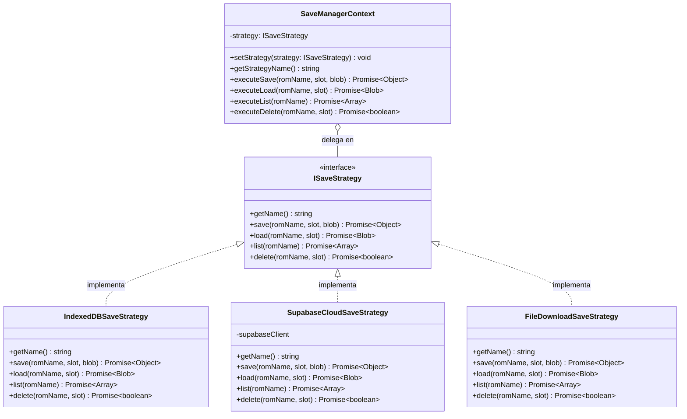

# Skill: Implementación del Prototipo del Patrón Strategy en EmulaMadro (Fase 3)

## 1. Objetivo de la Skill
Actúa como un Arquitecto de Software experto en React y Patrones de Diseño (GoF). Tu objetivo es refactorizar y extender de forma limpia y no destructiva el subsistema de guardado de partidas (*Save States*) del proyecto **EmulaMadro** aplicando el **Patrón de Diseño Comportamental Strategy**.

El prototipo resultante debe:
1. Representar y solucionar la problemática de rigidez en el almacenamiento de partidas (`useSaveStates.js` y `EmulatorToolbar.jsx`).
2. Implementar estrictamente la estructura del patrón **Strategy** (`ISaveStrategy`, Estrategias Concretas, `SaveContext` y Cliente).
3. Evidenciar en consola y en la interfaz gráfica (UI) el intercambio dinámico de estrategias en tiempo de ejecución (**Servidor Local / IndexedDB**, **Nube / Supabase** y **Archivo Físico `.state`**).
4. Mantener intacta la compatibilidad con el emulador actual (`RetroEmulator.jsx` y `App.jsx`).

---

## 2. Arquitectura del Patrón a Implementar (Mapeo de Participantes)

---

## 3. Instrucciones Paso a Paso

### Paso 1: Crear el módulo del Patrón Strategy (`src/strategies/saveStrategies.js`)
Crea el archivo `src/strategies/saveStrategies.js` que contendrá la interfaz base (`ISaveStrategy`), las 3 estrategias concretas (`IndexedDBSaveStrategy`, `SupabaseCloudSaveStrategy`, `FileDownloadSaveStrategy`) y el Contexto (`SaveManagerContext`). Este archivo debe incluir logs descriptivos en consola (`console.info`) para evidenciar qué participante del patrón está actuando en cada momento:

- **`ISaveStrategy` (Strategy):** Define el contrato (`getName()`, `save()`, `load()`, `list()`, `delete()`).
- **`IndexedDBSaveStrategy` (ConcreteStrategy A):** Persiste en IndexedDB (`EmulaMadroStrategyDB` / `save_states`) por `${romName}_slot_${slot}` sin latencia de red.
- **`SupabaseCloudSaveStrategy` (ConcreteStrategy B):** Persiste en la nube usando el bucket real de Supabase Storage (`emulamadro` en `saves/${safeRomKey}/slot_${slot}.state`) con respaldo en caché local cuando Supabase no esté disponible o sin conexión, evitando además los errores de borrado con RLS mediante fallback `.trash/`.
- **`FileDownloadSaveStrategy` (ConcreteStrategy C):** Exporta inmediatamente el estado binario como archivo `${romName}_slot${slot}.state` y permite reimportarlo en sesión o desde el selector de archivos del sistema operativo.
- **`SaveManagerContext` (Context):** Mantiene referencia a una instancia de `ISaveStrategy`, valida herencia en `setStrategy()`, registra el cambio de estrategia en caliente en consola y delega todas las operaciones sin condicionales `if/switch`.
- **`AVAILABLE_STRATEGIES`:** Mapa `{ local, cloud, file }` consumido por el Cliente.

### Paso 2: Refactorizar el Cliente (`src/useSaveStates.js`)
Actualiza `src/useSaveStates.js` para que actúe como el **Cliente** del patrón Strategy:
- Instancia `SaveManagerContext` vía `useRef(new SaveManagerContext(AVAILABLE_STRATEGIES.local))`.
- Mantiene compatibilidad total con la firma `{ nostalgistRef, romFile, emuWrapperRef }` de `RetroEmulator.jsx` y las acciones rápidas (`handleQuickSave`, `handleLoadStateBrowser`, `handleDownloadSave`, `handleUploadState`, `savingRef`), delegándolas al `SaveManagerContext` en lugar de acoplarse directamente a `backend/saveManager.js`.
- Expone `slots`, `activeSlot`, `setActiveSlot`, `busy`, `toast`, `strategyKey`, `activeStrategyName`, `changeStrategy`, `saveSlot`, `loadSlot`, `deleteSlot`, `refreshSlots`.

### Paso 3: Conectar el selector visual de Estrategia en `src/EmulatorToolbar.jsx` y `src/RetroEmulator.jsx`
1. En `src/RetroEmulator.jsx`, extrae las propiedades y acciones del cliente `useSaveStates` y pásalas a `<EmulatorToolbar />`, además de mostrar las notificaciones no bloqueantes (`toast`) sin interrumpir el emulador ni conexiones WebRTC.
2. En `src/EmulatorToolbar.jsx`, añade el botón **Slots** en la barra de herramientas para desplegar el panel de gestión de partidas, con:
   - El selector superior **"Motor de Guardado (Patrón Strategy)"** (`local`: `Local (IndexedDB)`, `cloud`: `Nube (Supabase Cloud)`, `file`: `Archivo Físico (.state)`).
   - La lista de slots (`Slot 1`, `Slot 2`, `Slot 3`) con fecha, tamaño, estado y botones **Guardar**, **Cargar** y **Eliminar** ejecutados directamente mediante la estrategia activa en `SaveManagerContext`.
3. Estiliza el panel y el selector acorde al tema CSS de EmulaMadro en `src/index.css`.

---

## 4. Guía de Verificación y Demostración Práctica (Para la Entrega)
1. Inicia el proyecto con `npm run dev` y abre cualquier juego (por ejemplo, *Contra* o *Super Mario World*).
2. Abre la consola del navegador (`F12`) y despliega el botón **Slots** en la barra inferior del emulador.
3. Selecciona **"Local (IndexedDB)"** y presiona **Guardar** en el Slot 1. Se verá en la UI el estado guardado y en la consola el log de `[ConcreteStrategy: IndexedDBSaveStrategy]`.
4. Cambia en tiempo de ejecución el selector a **"Nube (Supabase Cloud)"** y guarda en el Slot 2. El `SaveManagerContext` cambiará de estrategia sin recargar el juego ni usar condicionales.
5. Cambia el selector a **"Archivo Físico (.state)"** y guarda en el Slot 1: el navegador descargará inmediatamente el archivo binario `.state` de la partida actual a tu computadora.
