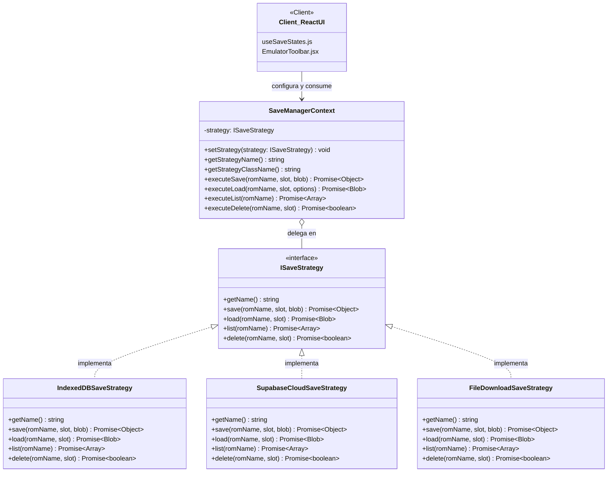

# EmulaMadro - Version 2

## Implementacion del Patron de Diseno Comportamental Strategy en el Subsistema de Guardado de Partidas

EmulaMadro es una plataforma web de emulacion de videojuegos retro multiconsola desarrollada con React 19 y Vite, con soporte para arquitecturas de NES, Super Nintendo y NeoGeo (mediante Nostalgist y RetroArch Emscripten), juego multijugador online P2P mediante WebRTC (PeerJS) y persistencia en la nube mediante Supabase.

La rama `version2` introduce la refactorizacion arquitectonica del subsistema de guardado de partidas (Save States), aplicando el patron de diseno comportamental Strategy (Gang of Four). Esta modificacion desacopla la logica de negocio de los mecanismos de almacenamiento concretos, permitiendo intercambiar motores de persistencia en tiempo de ejecucion sin recargar el emulador ni interrumpir sesiones multijugador.

---

## 1. Contexto y Problematica Identificada

### Situacion previa (Version 1)
En la implementacion inicial (`version1` y rama `main` en produccion), la persistencia de estados dependia de llamadas directas y acopladas dentro de `useSaveStates.js` y `backend/saveManager.js`. El subsistema enfrentaba las siguientes limitaciones:

- Acoplamiento rigido: La logica de guardado y carga estaba fuertemente ligada a un flujo fijo que combinaba llamadas a IndexedDB y Supabase Storage bajo un mismo bloque procedural.
- Uso de condicionales extensos: Para incorporar variantes de almacenamiento o gestionar contingencias de conexion, el codigo dependia de estructuras condicionales (if/else o switch), mezclando la coordinacion del emulador con detalles de infraestructura.
- Dificultad de extension (Violacion de OCP): Agregar un nuevo medio de almacenamiento (como exportacion directa a archivos fisicos o almacenamiento local ligero) obligaba a modificar archivos criticos del emulador, aumentando el riesgo de regresiones en funciones existentes.
- Violacion del principio de responsabilidad unica (SRP): El modulo de estados debia encargarse simultaneamente de coordinar la captura binaria de RetroArch, manipular la interfaz de usuario, procesar fallbacks offline y atender transferencias de red.

### Solucion adoptada
Se implemento el Patron Strategy para aislar cada algoritmo de guardado en clases independientes bajo un contrato comun, gestionadas por un Contexto que delega las operaciones polimorficamente.

---

## 2. Arquitectura del Patron Strategy

El subsistema se compone de cuatro participantes fundamentales:



---

## 3. Mapeo de Componentes y Responsabilidades

### Participante 1: Strategy (Interfaz / Contrato Base)
- Archivos: `src/strategies/saveStrategies.js` (`ISaveStrategy`) y `src/saveStrategies.js` (`SaveStrategy`).
- Responsabilidad: Define la firma obligatoria de operaciones que toda estrategia debe cumplir:
  - `getName()`: Retorna el nombre descriptivo del motor.
  - `save(romName, slot, data)`: Persiste el volcado de memoria.
  - `load(romName, slot)`: Recupera los datos del estado solicitado.
  - `list(romName)`: Retorna el listado de slots disponibles con metadatos (tamano, fecha).
  - `delete(romName, slot)`: Elimina el estado del slot seleccionado.

### Participante 2: Concrete Strategies (Estrategias Concretas)
1. Almacenamiento Local (IndexedDB):
   - Clase: `IndexedDBSaveStrategy` en `src/strategies/saveStrategies.js`.
   - Caracteristicas: Persiste volcados binarios pesados en la base de datos `EmulaMadroStrategyDB` dentro del object store `save_states`. Es ideal para sesiones rapidas sin latencia de red ni limites estrictos de cuota.
   - Complemento de consola: `LocalStorageSaveStrategy` en `src/saveStrategies.js` para pruebas directas en DevTools con serializacion JSON.

2. Almacenamiento en la Nube (Supabase Storage):
   - Clase: `SupabaseCloudSaveStrategy` en `src/strategies/saveStrategies.js`.
   - Caracteristicas: Sincroniza estados binarios en el bucket `emulamadro` bajo la ruta `saves/{romKey}/slot_{slot}.state`. Incluye compatibilidad hacia atras para leer partidas de la version 1 (`saves/{romKey}/state.bin`) en el Slot 1, tolerancia a fallos mediante espejo local (`localStorage`) cuando el cliente pierde conexion y eliminacion segura mediante reubicacion a `.trash/` si existen politicas RLS de solo lectura.
   - Complemento de consola: `SupabaseSaveStrategy` en `src/saveStrategies.js`.

3. Archivo Fisico Descargable (.state):
   - Clase: `FileDownloadSaveStrategy` en `src/strategies/saveStrategies.js`.
   - Caracteristicas: Exporta de forma inmediata el volcado binario de memoria generando una descarga en el navegador con el formato `<juego>_slot<numero>.state`. Permite ademas la carga dinamica del archivo desde el selector de archivos del sistema operativo mediante un elemento input de tipo file.
   - Complemento de consola: `FileSaveStrategy` en `src/saveStrategies.js`.

### Participante 3: Context (Contexto)
- Clases: `SaveManagerContext` en `src/strategies/saveStrategies.js` y `SaveContext` en `src/saveStrategies.js`.
- Responsabilidad:
  - Mantiene la referencia activa a una instancia que hereda de `ISaveStrategy`.
  - Valida en construccion y en `setStrategy()` que el objeto cumpla con el contrato.
  - Expone los metodos de ejecucion (`executeSave`, `executeLoad`, `executeList`, `executeDelete`).
  - No contiene sentencias condicionales acopladas a tipos de almacenamiento; toda peticion se delega directamente al objeto estrategia configurado.

### Participante 4: Client (Cliente React y UI)
- Archivos: `src/useSaveStates.js`, `src/EmulatorToolbar.jsx`, `src/RetroEmulator.jsx` y `src/main.jsx`.
- Responsabilidad:
  - `useSaveStates.js`: Instancia el contexto con la estrategia por defecto (`AVAILABLE_STRATEGIES.local`) mediante `useRef`, gestiona el estado reactivo (`strategyKey`, `slots`, `activeSlot`, `busy`, `toast`) y expone las acciones hacia la vista.
  - `EmulatorToolbar.jsx`: Renderiza el boton "Slots", el selector desplegable "Motor de Guardado (Patron Strategy)" y la administracion de los Slots 1, 2 y 3 con botones dedicados de guardado, carga y eliminacion.
  - `RetroEmulator.jsx`: Despliega notificaciones no bloqueantes (`.strategy-toast`) para alertar al usuario sin congelar el renderizado del emulador ni bloquear conexiones WebRTC en partidas multijugador.
  - Preservacion de SRAM: Mantiene intacto el guardado automatico cada 5 segundos de la memoria de bateria del juego (`saveSram`/`loadSram` en `backend/saveManager.js`).

---

## 4. Estructura de Archivos del Proyecto

Los archivos principales involucrados en la Version 2 son:

```text
emulamadro/
|-- .agents/skills/
|   `-- implementacion-patron-strategy-emulamadro/
|       `-- SKILL.md                  # Especificacion tecnica de la implementacion
|-- backend/
|   `-- saveManager.js                # Auto-guardado de SRAM cada 5s (preservado)
|-- src/
|   |-- strategies/
|   |   `-- saveStrategies.js         # ISaveStrategy, IndexedDB, Supabase Storage,
|   |                                 # FileDownload y SaveManagerContext
|   |-- EmulatorToolbar.jsx           # Panel visual de slots y selector de estrategia
|   |-- RetroEmulator.jsx             # Contenedor del emulador y notificaciones toast
|   |-- index.css                     # Estilos visuales del drawer y selector de slots
|   |-- main.jsx                      # Inicializacion y exposicion global para pruebas
|   |-- saveStrategies.js             # Implementacion complementaria para consola F12
|   |-- supabaseClient.js             # Cliente oficial de Supabase
|   `-- useSaveStates.js              # Hook React que actua como cliente del patron
|-- package.json
`-- README.md                         # Documentacion del proyecto (version 2)
```

---

## 5. Como Probar y Demostrar el Patron

### Metodo A: Desde la Interfaz Grafica (UI)
1. Iniciar el servidor local:
   ```bash
   npm run dev
   ```
2. Abrir la aplicacion en el navegador (habitualmente `http://localhost:5173`).
3. Cargar cualquier juego disponible (por ejemplo, Contra, Super Mario Bros 3 o Metal Slug 3).
4. Abrir las herramientas de desarrollo del navegador pulsando la tecla F12 y situarse en la pestana Console.
5. En la barra inferior del emulador, pulsar el boton "Slots".
6. Probar el intercambio dinamico de motores:
   - Motor Local (IndexedDB): Seleccionar "Local (IndexedDB)" y pulsar "Guardar" en el Slot 1. En la consola se observara el registro `[ConcreteStrategy: IndexedDBSaveStrategy]`.
   - Motor Nube (Supabase Cloud): Cambiar el selector superior a "Nube (Supabase Cloud)" y pulsar "Guardar" en el Slot 2. El contexto registrara el cambio en caliente (`[Context: SaveManagerContext] Cambiando estrategia...`) y subira el archivo al bucket `emulamadro`.
   - Motor Archivo Fisico (.state): Cambiar el selector a "Archivo Fisico (.state)" y pulsar "Guardar" en cualquier slot. El navegador descargara inmediatamente un archivo binario `.state` a la carpeta de descargas del equipo.

### Metodo B: Desde la Consola del Navegador (F12)
Para facilitar revisiones evaluativas sin necesidad de cargar un juego previamente, el punto de entrada `src/main.jsx` expone instancias del patron en el objeto `window`:

```javascript
// 1. Ejecucion con la estrategia por defecto: LocalStorage
await saveContext.executeSave("MarioDemo", 1, { nivel: 4, vidas: 3 });
await saveContext.executeLoad("MarioDemo", 1);

// 2. Intercambio en tiempo de ejecucion a Archivo Descargable (.state)
saveContext.setStrategy(new FileSaveStrategy());
await saveContext.executeSave("MarioDemo", 1, { nivel: 4, vidas: 3 });

// 3. Intercambio en tiempo de ejecucion a Nube (Supabase)
saveContext.setStrategy(new SupabaseSaveStrategy());
await saveContext.executeSave("MarioDemo", 1, { nivel: 4, vidas: 3 });
await saveContext.executeLoad("MarioDemo", 1);
```

---

## 6. Verificacion de Calidad y Compilacion

El codigo implementado en la rama `version2` cumple con los estandares del proyecto:

- Analisis estatico de codigo (Linter):
  ```bash
  npx oxlint src/main.jsx src/saveStrategies.js src/strategies/saveStrategies.js src/useSaveStates.js src/EmulatorToolbar.jsx
  ```
  Resultado: 0 errores y 0 advertencias en los modulos del patron.

- Compilacion de produccion:
  ```bash
  npm run build
  ```
  Resultado: Compilacion exitosa con Vite sin fallos de empaquetado.

---

## 7. Beneficios Tecnicos Obtenidos

- Cumplimiento del Principio Abierto/Cerrado (OCP): Es posible anadir nuevas estrategias de guardado (por ejemplo, Google Drive o Dropbox) creando una nueva clase que herede de `ISaveStrategy`, sin alterar el codigo de `SaveManagerContext`, `RetroEmulator.jsx` ni `useSaveStates.js`.
- Cumplimiento del Principio de Responsabilidad Unica (SRP): Cada clase concreta responde exclusivamente por la comunicacion con su respectiva API de persistencia, dejando la coordinacion general en manos del contexto.
- Mayor Testabilidad: Cada estrategia puede probarse de forma aislada mediante pruebas unitarias sin requerir el montaje del canvas de RetroArch ni la carga de dependencias de emulacion.
- Experiencia de Usuario sin Bloqueos: Se sustituyeron las llamadas sincronas `alert()` por un sistema de notificaciones no intrusivas en pantalla, manteniendo la sincronizacion de audio, video y conexiones P2P en segundo plano.

---

## 8. Ramas del Repositorio

- `main`: Version actual desplegada en produccion (Vercel).
- `version1` (tag `v1.0`): Respaldo historico del estado previo a la refactorizacion.
- `version2`: Rama de desarrollo donde reside esta implementacion completa del Patron Strategy.
